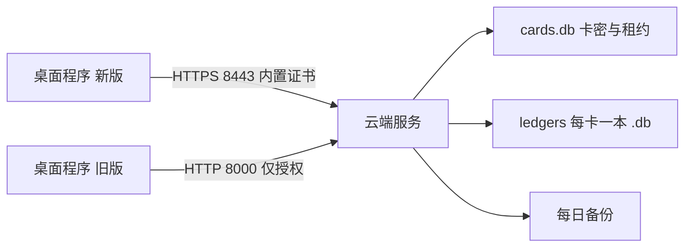

# 云端账本开发计划

状态：已和用户确认方案，**还没有开始写代码**。上面每一项做完后把 `status` 改成 `completed`。

## 已定的前提

- 部署在云服务器上，先用现在这台阿里云（`47.95.146.168`），以后可以换机器。
- 每张卡密一本独立的账，不同卡之间互相看不到。续费是同一张卡加天数，账不变。
- 同一时间仍然只有一台电脑在线记账，沿用现在的卡密独占租约。
- 一直用服务器 IP，不买域名。

## 整体结构

记账规则不重写。服务器直接用现有的 [app/services.py](../../app/services.py) 和 [app/db.py](../../app/db.py)：开一局、加押金、退押金、划转、茶水记忆、负数规则、排序、迁移旧库，都和本机版完全一样。桌面程序只是把「直接打开本地数据库」换成「发请求给服务器」。

## 一、服务端

在 [license_server/](../../license_server) 里扩展，同一个进程同时提供授权和账本。

- **每卡一本账**：`/opt/neizhanjizhang/data/ledgers/<卡密的 sha256 前 16 位>.db`。文件名不直接用卡密，备份文件外泄时看不出是哪张卡。第一次登录时自动建空账。
- **登录换令牌**：`/v1/session` 登录成功后，除了现在的 `expires_at`，再返回一个随机令牌，存进 `cards` 表。之后所有账本请求都带这个令牌。服务器每次都核对三件事：令牌对得上、卡没过期、租约还在这台机器上。任何一条不满足就拒绝写入。下线或租约被别的机器接走时，令牌作废。
- **账本接口** `POST /v1/ledger/<动作>`：一一对应 `services.py` 里界面用到的函数，包括 `list_players`、`list_session_players`、`get_player`、`create_player`、`import_players`、`update_remark`、`delete_player`、`add_deposit`、`refund`、`transfer`、`preview_session`、`open_session`、`list_ledger`、`get_last_tea_cents`、`set_last_tea_cents`。业务错误（例如押金不足）沿用 `AppError` 的中文提示原样返回。
- **防止重复扣钱**：每个写操作带一个客户端生成的请求编号，服务器在这本账里记下最近处理过的编号。网络超时后客户端重试，同一编号不会再开一局、再加一次押金。
- **并发**：每本账一把锁，SQLite 连接只在服务进程里打开。现在共用一个 SQLite 连接的问题（之前列为已知缺口）这次一起改成加锁。
- **整本备份与导入**：`/v1/ledger/export` 下载这张卡的整本 `.db`；`/v1/ledger/import` 上传一个 `.db`，替换前先在服务器上备份，并用现有的 `validate_ledger_file` 校验。导入时同样去掉只读属性。
- **试用**：现在的「空卡密或乱填也能进」不能拿到云端账，否则所有试用者会进同一本账。云端版改成发短期试用卡，例如 `issue.py --days 3`。旧版本的开放试用保持不变，直到旧版停用。
- **管理命令**（[license_server/issue.py](../../license_server/issue.py)）：新增 `--move-ledger 旧卡 新卡`，给换卡的客户把账转过去；`--list` 里增加每张卡的账本大小和最后写入时间。
- **HTTPS**：没有域名，就为 IP 生成一张 10 年期的自签名证书，SAN 写服务器 IP。新端口 8443 使用 TLS；旧的 HTTP 8000 只保留登录、心跳、下线，给旧版本用。证书和私钥放在 `/opt/neizhanjizhang/tls/`，迁移服务器时要一起拷走。
- **备份**：systemd timer 每天凌晨用 SQLite 备份接口导出 `cards.db` 和整个 `ledgers/`，打成一个带日期的压缩包，保留 30 天。再加一个本机脚本 `tools/pull_backup.py`，把最新备份拉到你电脑上，避免服务器到期时数据一起没了。

## 二、桌面程序

- **新增** `app/remote.py`：`RemoteLedger` 类，方法名和参数与上面的接口一一对应，内部走 HTTPS。服务器返回业务错误时抛 `AppError`；连不上时抛「无法连接服务器，这次操作没有保存」。读操作超时可以重试；写操作带上请求编号再重试。
- [app/ui.py](../../app/ui.py)：约 25 处 `xxx(self.db.conn, ...)` 改成 `self.ledger.xxx(...)`，页面布局和交互不变。状态栏不再显示本机账本路径，改成显示「云端账本」加到期日。
- **Excel 导出**：`export_player_workbook` 改成接收玩家列表，在本机生成文件，不需要把 Excel 放到服务器上。
- **交接班页**：日常换人不再需要导出、导入，直接换电脑登录。页面改成「下载账本备份」和「用本机账本覆盖云端」，后者要二次确认，并说明服务器会先自动备份。
- [app/main.py](../../app/main.py)：登录成功后创建 `RemoteLedger`，不再打开本地 `Database`。第一次登录时，如果云端是空账，而 exe 旁边还有旧版留下的 `data\deposit.db`，就提示「要把本机原来的账本上传到云端吗？」。这样老客户升级时一步就能把账带上来。
- [app/license_client.py](../../app/license_client.py)：地址改为 `https://47.95.146.168:8443`，用打包进去的 `app/assets/server.crt` 建 SSL 上下文，只信任这张证书。登录拿到令牌后交给 `RemoteLedger`。心跳失败锁窗口的逻辑不变；锁住之后，没有保存的写操作不会被假装成功。
- **服务器地址可覆盖**：如果 exe 旁边有 `server.txt`，就用里面的地址。以后换服务器 IP 时，只要给客户发一个小文件，不必重新安装。证书不变的前提是迁移时把私钥一起拷到新机器。
- 账本只在云端之后，本机的单实例锁仍然保留，避免同一台电脑开两个窗口。

## 三、测试

- [tests/test_ledger.py](../../tests/test_ledger.py) 的规则测试不动，继续保证 `services.py` 的行为。
- 新增 `tests/test_cloud.py`：在本机起一个带测试证书的服务，覆盖这些情况：
  - 两张卡看不到对方的账。
  - 令牌错误、卡过期、租约被别的机器接走时，写入都被拒绝。
  - 同一个请求编号重复发送，不会开两局。
  - 导出再导入后，数据完全一致。
  - 只读的 `.db` 也能导入。
  - 旧的 HTTP 8000 登录照常可用。
- `RemoteLedger` 对接测试服务，把开一局、退押金、划成负数、默认金额相关的读取各走一遍。

## 四、部署与切换

1. 本机写完、测试通过后，在服务器上生成证书，装上新代码。systemd 同时监听 8000 和 8443，阿里云安全组放行 8443，再打开每日备份。
2. 你自己先发一张卡，用新版本登录。上传一份现有账本，在两台电脑上分别登录，确认看到的是同一本账，并且两台不能同时在线。
3. 给现有客户发新安装包。他们第一次登录时按提示上传本机账本，之后就在云端记账。
4. 所有人都换到新版后，关掉旧的开放试用。等旧版不再有人登录，再关掉 HTTP 8000。官网文案在这时一起改成云端版的说法。

## 以后换服务器

每次要搬的东西是固定的：`cards.db`、`ledgers/` 目录、`tls/` 目录（证书和私钥），再加上代码。新机器装好、拷进这三样之后，给客户发一个写着新 IP 的 `server.txt`，旧服务器即可到期。这些步骤会写进 [license_server/部署说明.txt](../../license_server/部署说明.txt) 和交接文档。

## 不在这一期

- 多人同时编辑同一本账。
- 一家店多张卡共用一本账。数据结构留了口子：卡和账本是映射关系，以后可以让多张卡指向同一个账本文件。
- 自动收款、网页买卡。
- 离线记账、联网后同步。
