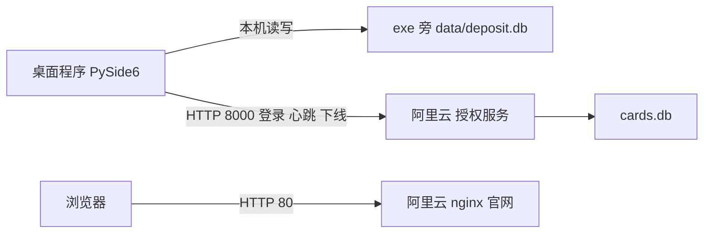

# 押金记账交接

给下一位接手这个仓库的人（人或 AI 都适用）。用户用简体中文沟通。

不要主动改授权服务器上的试用开关，不要主动提交 git，不要改 `C:\Users\Administrator\.cursor\plans\` 下的原始计划文件。

## 一、现在到哪一步了

截至 2026-10-30：

- **本机版已完成并在用。** Windows 桌面程序，账本是每台电脑 exe 旁边的 `data\deposit.db`。上一轮要求的功能都已做完、打包、发到官网，没有进行中的代码改动。
- **全部测试通过。** 在 `neizhanjizhang` 目录执行 `python -m pytest tests -q`，27 项通过。
- **安装包**：`release\押金记账.zip`，248 个文件，不含 `data`。官网上挂的是 `yajinjizhang-20261030.zip`，版本 2026.10.30。
- **官网**：`http://47.95.146.168/`，已同步 10-30 的新功能。
- **下一阶段：云端账本。** 方案已经和用户确认，还没开始写代码。计划在 [docs/plans/云端账本开发计划.md](docs/plans/云端账本开发计划.md)，见本文第十一节。

最近两天加的功能（用户可能会问到）：

- 玩家库：搜索框（游戏 id 或备注）；押金三色提醒。
- 开一局：「选前10个」；名单按最近扣茶水排序；勾选框放大，点一行任意位置都能勾选。
- 押金记录：划给其他人可以划成负数，先弹窗确认；退押金默认填全部余额，划给其他人默认是茶水的 10 倍。
- 导入别人发来的账本时，不再把「只读」属性带进来；程序文件夹不能写时给出中文提示。

## 二、文档地图

| 文档 | 内容 |
| --- | --- |
| [AGENTS.md](AGENTS.md) | 给编程工具自动读取的短指令。只写必须遵守的规矩，细节指向本文。 |
| 本文 | 现状、结构、规则、运维、坑。先读这份。 |
| [docs/plans/云端账本开发计划.md](docs/plans/云端账本开发计划.md) | 下一阶段计划，已入仓库，以它为准。 |
| [license_server/部署说明.txt](license_server/部署说明.txt) | 服务器上的发卡、续期、试用、systemd 命令。 |
| `C:\Users\Administrator\.cursor\plans\本地押金记账_7210635a.plan.md` | 最初的本机版计划。只在这台电脑的 Cursor 里，不在仓库。 |
| `C:\Users\Administrator\.cursor\plans\卡密独占登录_f32c9b6a.plan.md` | 卡密独占登录的计划。同上。 |

前两份旧计划的内容已经被代码和本文覆盖，换了开发环境找不到也不影响接手。

## 三、整体结构



- 玩家、押金、流水、茶水全部在各台电脑本地，**不上传**。
- 云服务器只做两件事：授权（8000）和官网（80）。服务器停了，程序登不进去，已经开着的大约 40 秒后被锁住；本地账本不受影响。
- 管理员不在同一地点。换人记账靠「交接班 → 导出账本 / 导入账本」整库交接。

## 四、仓库与模块

工作区 `C:\Users\Administrator\Desktop\code\a`，程序在 `neizhanjizhang\`。

| 路径 | 作用 |
| --- | --- |
| `app\main.py` | 入口。打包后把未捕获异常写进 exe 旁的 `error.log`；`data\app.lock` 单实例锁；登录循环；打开账本；账本打不开（`AppError`）时先登出授权再弹中文提示。 |
| `app\ui.py` | 全部界面。`PlayersPage`、`SessionPage`、`LedgerPage`、`HandoverPage` 四个页，`LoginDialog`，`MainWindow`（心跳定时器、锁窗口、状态栏）。对话框：`PlayerDialog`、`ImportPlayersDialog`、`AmountDialog`。开一局的勾选格是 `CheckCell`。样式表 `app_stylesheet()` 也在这里。 |
| `app\services.py` | 全部记账规则。金额解析 `parse_yuan` / `format_yuan`；玩家增删改、批量导入；开局 `preview_session` / `open_session`；`add_deposit`、`refund`、`transfer`；`list_players`、`list_session_players`、`list_ledger`；茶水记忆；`deposit_level`、`find_player_rows`；Excel 导出。出错一律抛 `AppError`（中文提示）。 |
| `app\db.py` | 建表与旧库迁移；`install_dir()`；整库导出 `export_to`、导入 `import_from`；`ensure_writable` 去掉只读；`validate_ledger_file` 校验导入文件。 |
| `app\license_client.py` | 登录、心跳、下线。服务器地址写死在 `DEFAULT_SERVER_URL`；`note_heartbeat` 决定何时锁窗口。 |
| `app\assets\` | `icon.svg`、`icon.ico`（由 `tools\make_icon.py` 生成）、`check.svg`、`chevron.svg`。打包时必须带上。 |
| `license_server\` | 授权服务，纯标准库 `http.server` + SQLite。`store.py` 是卡密与租约逻辑，`http.py` 是接口，`issue.py` 是服务器上用的管理命令。 |
| `tests\` | `test_ledger.py` 账本规则 16 项；`test_license.py` 客户端 5 项；`test_license_server.py` 服务端 6 项。 |
| `site\` | 官网，纯静态（`index.html`、`assets\style.css`、`assets\site.js`、`downloads\`）。 |
| `tools\build_site.py` | 把 `release` 里的包放进官网并生成下载清单。 |
| `tools\deploy_site.py` | 发布官网到阿里云并校验。 |
| `tools\make_icon.py` | 从 SVG 生成 ico。 |
| `launch.py` | PyInstaller 入口。 |
| `run.bat` / `build.bat` | 源码启动 / 打包。 |
| `docs\plans\` | 入仓库的计划。 |

依赖：本机 Miniconda 的 Python 3.13.9；`requirements.txt` 是 PySide6、openpyxl、pytest。界面用 PySide6 Fusion 风格，字体 Microsoft YaHei UI。

## 五、数据

### 账本 `deposit.db`

| 表 | 字段 |
| --- | --- |
| `players` | `game_id`（主键）、`nickname`（界面已不用）、`deposit_cents`、`games_played`、`remark`、`created_at`、`updated_at` |
| `sessions` | `id`、`tea_fee_cents`、`note`、`created_at`（每一局一行） |
| `ledger` | `id`、`player_game_id`、`session_id`、`reason`、`amount_cents`、`balance_before_cents`、`balance_after_cents`、`counterparty_game_id`、`transfer_group_id`、`note`、`created_at` |
| `settings` | `key`、`value`。用到的只有 `last_tea_cents`；`default_tea_cents` 会被写成 0，界面不用。 |

- 金额全部是**整数分**，界面显示两位小数的元。不要引入浮点金额。
- 连接用 `isolation_level=None`，写入走显式事务（`services.transaction`）；`journal_mode = DELETE`；外键开启。
- 旧库打开时自动迁移：没有 `remark` 列就加上；旧库里「押金和余额不能小于 0」的检查会去掉，因为开局可以扣成负数。
- 时间是本机时间字符串。

### 卡密库 `cards.db`（只在服务器上）

- `cards`：`card`、`expires_at`、`holder_machine_id`、`last_seen`、`created_at`。
- `settings`：`trial` = `1` / `0`。
- 时间按中国时区（UTC+8），格式 `YYYY-MM-DD HH:MM:SS`。
- 卡密格式 `XXXX-XXXX-XXXX`，字母表去掉了容易混淆的字符。

### 本机配置 `data\license.json`

只存 `server_url`、`card`、`machine_id`（首次运行生成的 uuid）。不存到期日。

## 六、各页面行为

### 玩家库

- 列：序号、游戏 id、押金、总局数、备注。序号只是当前排序下的行号，不是库里的 id。
- 排序：总局数从高到低，再按游戏 id 的**文本序**（所以 `"10"` 排在 `"2"` 前面）。
- 总押金在页面右上角的卡片和窗口状态栏里。
- 搜索框：按游戏 id 或备注模糊查找，id 完全一致的排第一。输入时定位到第一个，回车跳到下一个，旁边显示「第几个/共几个」或「没找到」。逻辑在 `services.find_player_rows`。
- 押金颜色（`services.deposit_level`）：低于 30 元红色加粗，鼠标停留提示「请及时补押金」（包含负数）；30 到 60 元（含 60）黄色；60 元以上绿色。被选中的那一行显示成普通深色字。
- 新增玩家：游戏 id 必填，备注可选。备注随时可改。
- 批量导入：一行一个，`游戏id` 或 `游戏id,备注`（英文逗号、中文逗号或制表符都可以）。空行和 `#` 开头的行跳过。已存在的 id 跳过，不覆盖押金和备注。可以从 txt/csv 读入，编码依次尝试 utf-8-sig、utf-8、gbk。
- 删除：只有押金**正好为 0** 才能删，有历史流水也可以删；删除时一并删掉这个人自己的流水。
- 双击游戏 id：跳到押金记录并查询这个人。

### 开一局

- 名单用 `list_session_players`：按这个人最近一条 `normal_deduct` 所在的局从新到旧；同一局里按流水 id；没扣过茶水的人排在最后。玩家库、Excel、押金记录的下拉框仍用 `list_players`，不要改成开一局的排序。
- 「选前10个」（`SessionPage._toggle_first`）：前 N 个（N 最多 10）正好全选、其余都没选时，再点一次就全部取消；否则勾上前 N 个、取消其余。不足 10 人时选全部。
- 勾选：方框 22px；点选择格任意位置（`CheckCell`）或这一行其他格子（`SessionPage._toggle_row`）都会切换。
- 茶水：确认前实时显示每人「本局扣除」「扣后押金」和状态。余额不够也能开局，扣完记为负数，确认框会列出这些人。茶水可以是 0。
- 确认开局（`open_session`）：建一行 `sessions` 记下当时的茶水，给每个选中的人写一条 `normal_deduct` 并让总局数加 1。之后再改茶水输入框，不影响已经开过的局。
- 茶水记忆：存在本账本的 `settings.last_tea_cents`，没有这行时显示 2.00。离开输入框（`editingFinished`）和关闭窗口时保存；输入不合法时不保存。它跟着账本走，交接导出时会一起带过去；光标还在输入框里就马上导出，文件里可能还是上一次保存的数。

### 押金记录

- 游戏 id 可以从下拉框选，也可以直接输入后点「查询」或回车。
- 加押金、退押金、划给其他人，**都作用在输入框里当前这个 id 上**。如果框里的字和上次查询的人不一样，会先按框里的 id 重新查询再操作（`_target_game_id`）。这里以前出过「钱加到别人账上」的 bug，不要再改回用上次查询的人。
- 退押金：默认填当前全部余额，余额小于等于 0 时留空；不能超过当前余额，所以负数账户退不了。
- 划给其他人：默认金额是 `last_tea_cents × 10`；不能划给自己；余额不够也能划，划完会变负数时先弹窗确认。两边各记一条流水（`transfer_out` / `transfer_in`），用同一个 `transfer_group_id` 配对。
- 默认金额已经全选，直接输入就替换。
- 流水列：时间、原因、变动金额、当时押金、操作后押金、对方、局号、备注。最新的在最上面。

### 交接班

- 导出账本：用 SQLite 备份接口写出一个完整的 `.db`。不要直接拷贝正在用的 `deposit.db`。
- 导入账本：先校验文件；再把当前账本备份成 `data\backup-before-import-*.db`；然后整库替换。替换失败会换回备份。替换用的是 `shutil.copyfile` 加 `ensure_writable`，**不要改回 `copy2`**，否则别人文件上的只读属性又会被带进来。
- 导出玩家库：Excel，列为序号、游戏 id、押金、总局数、备注，顺序和玩家库一致。它只是快照，不能代替账本交接。

### 登录与主窗口

- 登录框只显示卡密输入框，占位文字「直接点击登录」。服务器地址不显示，`values()` 永远返回 `DEFAULT_SERVER_URL`。
- 同一台电脑重复打开会提示「程序已在运行」。
- 状态栏：账本路径、玩家人数、总押金、卡密到期日。

## 七、授权

### 接口

全部是 `POST`，JSON 请求体 `{"card": "...", "machine_id": "..."}`：

| 路径 | 作用 |
| --- | --- |
| `/v1/session` | 登录。成功 `200 {"ok": true, "expires_at": "..."}`。 |
| `/v1/session/heartbeat` | 心跳，刷新租约。 |
| `/v1/session/logout` | 下线，立刻让出这张卡。 |

失败：`409 in_use`（这张卡正在另一台电脑上使用）；`403 expired` / `invalid`。`GET /` 返回 `{"ok": true}`，用来看服务活着没有。

### 规则

- 同一张卡可以装在多台电脑上，同一时间只有一台在线。第二台登录会被拒绝，第一台不会被踢掉。
- 租约 60 秒（`LEASE_SECONDS`）。正常关闭程序会立刻登出；崩溃或断网时，约 60 秒没有心跳，别的电脑才能登录。
- 客户端每 20 秒心跳一次，单次超时 8 秒。连续两次连不上就锁住主窗口，只能退出；卡被占用、过期或无效时立刻锁住。
- 续期：在原卡上加天数。没到期从原到期日往后加，已过期从当天往后加。卡密不变，正在用的人不用重登。
- 试用开关（服务器 `settings.trial`）：开启时，空卡密或没登记的卡密都能登录，返回的到期日是「试用」，不占租约；已经发放的卡仍然一台一台地用。关闭后只接受已发放的卡。切换试用不需要重新打包桌面程序。

**上次会话结束时试用是开着的，服务器上也有已发出去的卡。** 卡密不要写进文档、不要提交、不要在回复里复述。动手前先在服务器上用 `--list` 看现状，不要凭记忆去关试用。

## 八、服务器

- 阿里云轻量服务器，Alibaba Cloud Linux 3，公网 IP `47.95.146.168`（机器内网 IP 是另一个，不要用）。
- SSH 用户 `admin`，只允许密钥登录，`sudo` 免密。本机私钥在 `C:\Users\Administrator\.ssh\aliyun_license`。**私钥内容不要写进仓库或文档。**
- 系统自带的 `python3` 是 3.6，跑不了这份代码；服务用 `/usr/bin/python3.11`。`部署说明.txt` 里的 systemd 示例写的是 `python3`，以服务器上实际的 unit 为准。
- 授权服务：systemd 单元 `license-server.service`，工作目录 `/opt/neizhanjizhang`，数据库 `/opt/neizhanjizhang/data/cards.db`，监听 `0.0.0.0:8000`。
- 官网：nginx 配置 `/etc/nginx/conf.d/neizhanjizhang.conf`，监听 80，根目录 `/opt/neizhanjizhang/site`。
- 安全组放行 TCP 80、8000。没有域名，也没有备案。

常用命令（在服务器 `/opt/neizhanjizhang` 里执行）：

```text
python3.11 -m license_server.issue --list --db data/cards.db               查看卡和占用
python3.11 -m license_server.issue --days 30 --db data/cards.db            发一张 30 天卡
python3.11 -m license_server.issue --card 卡密 --days 30 --db data/cards.db 续 30 天
python3.11 -m license_server.issue --trial on|off --db data/cards.db       试用开关
sudo systemctl restart license-server                                      重启授权服务
```

**`cards.db` 只在服务器上，本机没有副本。** 服务器到期或被回收前，必须先把它拷下来，否则已发出的卡和到期日全部丢失。换服务器还要改 `DEFAULT_SERVER_URL` 并重新打包，因为地址写死在程序里。

## 九、开发、打包、发布

源码运行：在 `neizhanjizhang` 里 `run.bat` 或 `python -m app.main`。源码运行用项目里的 `data\deposit.db`，打包后用 exe 旁边的 `data\deposit.db`，**这是两个不同的文件**。

发新版的完整步骤：

1. 改代码，跑 `python -m pytest tests -q`。
2. 打包（与 `build.bat` 相同）：

   ```text
   python tools\make_icon.py
   python -m PyInstaller --noconfirm --windowed --name 押金记账 --icon app\assets\icon.ico --add-data "app\assets;app\assets" launch.py
   ```

   产物在 `dist\押金记账\`，`押金记账.exe` 必须和 `_internal` 文件夹放在一起。
3. 打 zip：把 `dist\押金记账\` 压成 `release\押金记账.zip`，压缩包里顶层目录叫 `押金记账`，**跳过路径里含 `data` 的文件**（不能把账本和 `license.json` 打进去）。目前没有专门的脚本，上几轮是用一小段 Python `zipfile` 做的。
4. 更新官网文案：首屏「本次更新」区块（`#new`）、四个页面的说明、常见问题、页脚更新记录都是手写的。程序规则改了，首屏可点的界面示意（`site\assets\site.js`）也要一起改，让它和程序一致。
5. `python tools\deploy_site.py`：它会先跑 `build_site.py`，把新包复制成 `site\downloads\yajinjizhang-YYYYMMDD.zip`，生成 `manifest.json`，并改写 `index.html` 里写死的下载地址、版本、大小和样式脚本的 `?v=` 时间戳；再整目录上传到服务器，最后比对线上清单的 sha256。

官网规定：页面里不写授权服务器地址，也不写任何卡密。

## 十、常见问题排查

| 现象 | 原因与处理 |
| --- | --- |
| 启动报 `attempt to write a readonly database` | 旧版导入别人发来的只读账本造成的。新版打开时会自动去掉只读，换新版即可。仍然失败说明程序放在不能写的目录（Program Files、压缩包里），会提示「账本无法写入」，换到普通文件夹。 |
| `run.bat` 最后提示「Install dependencies」 | 这是固定文案，任何启动失败都会这样提示。真正原因要看上面的 traceback。 |
| 打包版闪退、没有窗口 | 看 exe 同目录的 `error.log`。 |
| 登录提示「无法连接授权服务器」 | 服务器、安全组或网络问题。先在浏览器打开 `http://47.95.146.168:8000/` 看有没有 `{"ok": true}`。 |
| 「这张卡正在另一台电脑上使用」 | 另一台还开着，或刚异常退出不满 60 秒。让对方正常关闭，或等一分钟。 |
| 「程序已在运行」 | 同一台电脑已经开了一个窗口；残留的 `data\app.lock` 超过 3 秒会被视为失效。 |
| Windows 弹「已保护你的电脑」 | 安装包没有代码签名。点「更多信息 → 仍要运行」。 |
| 改了数据却在另一份账本里找不到 | 先确认用的是源码版还是打包版，两边的 `data\deposit.db` 不是同一个文件。 |

## 十一、下一阶段：云端账本

计划见 [docs/plans/云端账本开发计划.md](docs/plans/云端账本开发计划.md)，状态是「已确认、未开始」。要点：

- 部署在云服务器（先用现在这台），地址一直用 IP，不买域名。
- 每张卡密一本独立的账，放在服务器上；同一时间仍然只有一台电脑在线。
- 服务器直接复用 `app\services.py` 和 `app\db.py`，记账规则不重写。桌面程序新增 `RemoteLedger`，替换 `ui.py` 里约 25 处 `xxx(self.db.conn, ...)` 调用。
- HTTPS 用 IP 自签名证书，客户端内置证书；旧版继续走 HTTP 8000，直到切换完成。
- 开放试用不能进云端账，要改成发短期试用卡。

动手前和用户确认这份计划仍然有效。做完一项就把计划文件头部对应 todo 的 `status` 改成 `completed`。

## 十二、git 注意

- 仓库根目录是 `C:\Users\Administrator\Desktop\code\a`，里面还有别的项目（如 `learn-fastapi`）。只动 `neizhanjizhang\`。
- `.gitignore` 已忽略 `build/`、`dist/`、`release/`、`site/downloads/*.zip`、`data/license.json`、`data/app.lock`、`data/backup-*.db`。
- **`neizhanjizhang/data/deposit.db` 目前被 git 跟踪。** 里面可能是真实的玩家和押金。是否移出仓库、是否清理历史，要先问用户，不要自己决定。
- `押金记账.spec` 是 PyInstaller 自动生成的，也在仓库里。
- 用户没要求时不要提交。

## 十三、用户已经确认过的取舍

- 不做账号系统，也不做「第一个管理员才能写」那种值班锁。现在的交接就是导出整个账本、在下一台电脑导入（云端版之后改成换电脑直接登录）。
- 茶水不是会改写旧局的全局设置，每局确认时单独记账。
- Excel 不能拿来交接押金历史，只是玩家库快照。
- 查询按钮要留着。卡密输入框要留着，提示语写「直接点击登录」。
- 玩家库按总局数排序；只有开一局按最近扣茶水排序。
- 押金颜色：低于 30 红、30 到 60 黄、60 以上绿。
- 开局和划给其他人可以变负数；退押金不行。
- 安装包可以手动发给别人；以后要按月卖卡密。

## 十四、已知缺口

- 不能撤销已确认的开局。总局数会留下，钱只能再用「加押金」补回去。用户没要求做。
- 授权服务多线程共用一个 SQLite 连接，偶发竞态没处理（云端计划里会一起改）。
- 服务器上的 `cards.db` 没有自动备份（云端计划里有每日备份）。
- `run.bat` 把任何启动失败都说成缺依赖。
- 打 zip 没有固定脚本。

## suggested skills

下一位如果继续改这个程序，先读对应技能再动手：

- 修一个已经出现的失败、报错或变慢：`C:\Users\Administrator\.claude\skills\diagnosing-bugs\SKILL.md`
- 加功能或改账本规则，并要先写测试（云端账本这一期很适合）：`C:\Users\Administrator\.claude\skills\tdd\SKILL.md`

没有新的故障或新功能时，不要为了走流程去调用这两个技能。
